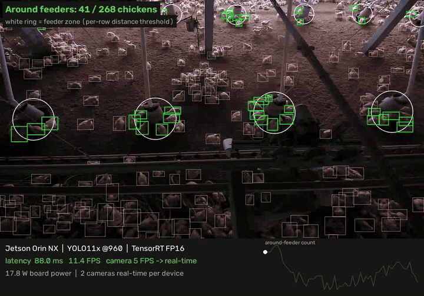
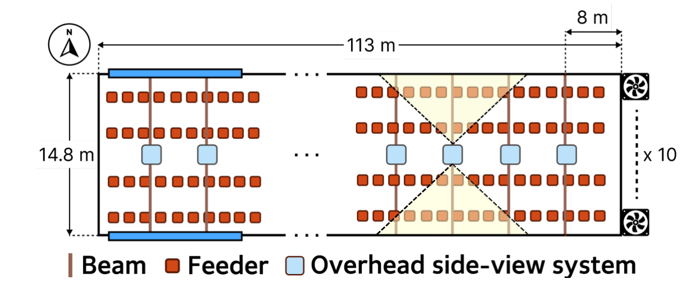
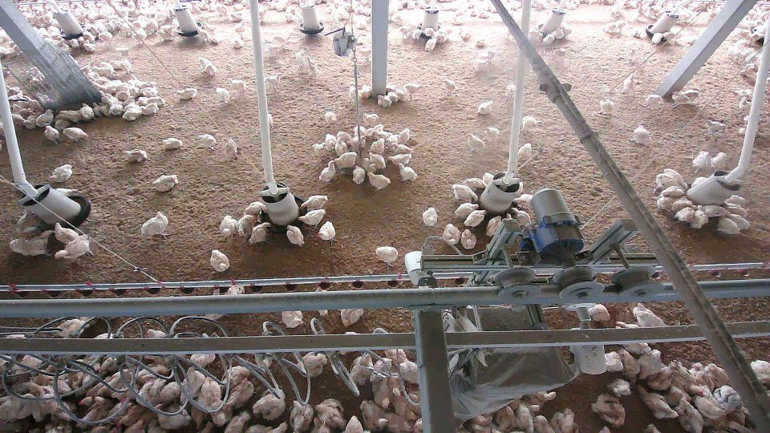
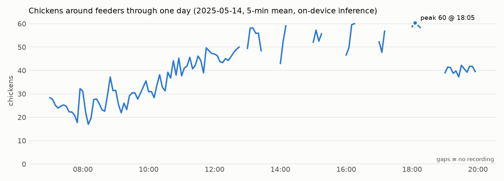
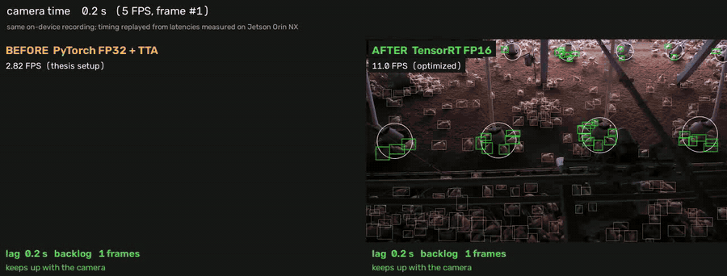
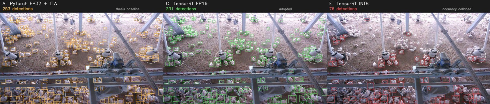

# edge-flock-counter

**How many poultry-house cameras can one Jetson Orin NX watch in real time? And what is the honest answer when the "free" accelerators don't help?**

This project counts chickens around feeders in a commercial broiler house, then moves the whole pipeline from an offline lab GPU onto an edge device. It is measured end to end, and the optimizations that failed are kept in the log next to the ones that worked.



*Real time, 5 FPS (the camera's frame rate). YOLO11x @960 detects about 230–320 chickens per frame. White rings are feeder zones; green boxes are chickens counted as around a feeder. The latency and power in the HUD were measured on the Jetson (TensorRT FP16). The boxes were re-rendered from the same model and clip on a workstation GPU, so the overlay could be drawn more clearly.*

---

## The story

In 2025, as an undergraduate at National Taiwan University, I proposed a system to find out **how the environment shapes when and how much broiler chickens eat**. IoT sensors would log temperature, humidity, CO₂, NH₃ and feeder-motor activity, and a deep-learning model would quantify feeding from overhead cameras. The two series would then be aligned and modelled together.

What I actually built was the vision half, up to one milestone: **counting chickens around feeders** (F1 0.617). The next step, telling a bird that is *eating* from one that is only *standing near* the feeder, never happened, because the project ended there.

One problem from the field stayed with me. The Raspberry Pis in the house could only record: the chicken model runs at **0.05 FPS** on a Pi 4, while the camera produces 5. Every frame went to a lab server, and covering the whole farm (10 houses, about 150 cameras) would mean moving about 1.75 TB of video a day. So I took the counting model and asked a systems question: **can the inference run on site instead?** This repo is that second chapter, porting the model to a Jetson Orin NX and measuring it end to end, including the optimizations that didn't work.

## Field setup



*One house is 113 m × 14.8 m, and the farm has 10 of them. Capture units hang on the central beams every 8 m. Each unit's two cameras cover the two halves of the house (shaded).*

| | |
|---|---|
| Capture unit | Raspberry Pi 4B (8 GB) + **two** 130° wide-FOV cameras, one facing each side of the house |
| Mounting | Overhead side view from the beam, **2.2 m** above the litter, looking down at an angle |
| Recording | 1920×1080 H.264 at **5 FPS**, saved as 5-minute clips, copied to the lab NAS for offline inference |
| Scene | Commercial broiler house with pan feeders in rows; 650–750 birds in one camera's view |



*An unannotated frame from one installed camera. The angled view is why far feeders look small and near ones look large, and why the feeder zones below need one radius per row.*

The proposal planned fisheye lenses with software undistortion; the installed system used 130° wide-FOV cameras instead.

## What it does

| | |
|---|---|
| **Function** | Detect every chicken in a 1080p frame, decide which ones are around a feeder, and log counts at 5 FPS for a whole day. The result is a feeding-rhythm time series. |
| **Edge** | Run that on a 15–25 W Jetson next to the camera instead of shipping 11.7 GB of video per camera per day to a lab server. |



*One full day (86 five-minute clips, about 129k frames) processed on the Jetson in 3.4 hours at 10.9 FPS. Data: [`docs/assets/feeding_rhythm_20250514_5min.csv`](docs/assets/feeding_rhythm_20250514_5min.csv).*

## How "around a feeder" is decided

The camera never moves, so the feeders are located once and cached in [`pipeline/config/cached_feeders.json`](pipeline/config/cached_feeders.json). On every frame after that:

1. **Two rows, two sizes.** The camera looks down at an angle, so far feeders look small and near ones look large. A 1-D K-means on the feeders' center y splits them into a **far row** and a **near row**.
2. **One radius per row, learned from labels.** On frames where *eating* chickens were labelled by hand, I measured the distance from each eating bird's box center to the center of its nearest feeder. Outliers were removed with the IQR rule (above Q3 + 1.5 × IQR), and the radius is the **90th percentile** of what remains. That gives **45.1 px for the far row and 94.2 px for the near row** at 1920×1080, so each ring contains 90% of the eating chickens observed in that row. ([`research/threshold.py`](research/threshold.py))
3. **Decision.** A chicken counts as around a feeder when its box center lies inside the ring of its nearest feeder.

This is a proximity rule, not a behavior classifier. Its two known failure modes: birds resting next to a feeder are counted (false positives), and birds eating at the edge of the frame are missed (false negatives). The thesis reports F1 0.617.

## Before → after



*Both panels show the same on-device recording. Frame timing is replayed from the latencies measured on the Jetson. The camera produces 5 FPS; the thesis setup finishes 2.8, so its backlog grows without limit.*

| Config (Jetson Orin NX, MAXN + `jetson_clocks`) | FPS | Latency | Power | FPS/W | Agreement with baseline detections |
|---|---:|---:|---:|---:|---|
| A. PyTorch FP32 + TTA (thesis setup) | 2.91 | 344 ms | 22.2 W | 0.13 | reference |
| B. TTA off | 6.48 | 154 ms | 20.9 W | 0.31 | R 0.87 / P 1.00 |
| C. TensorRT FP16 | 12.10 | 83 ms | 18.7 W | 0.65 | R 0.87 / P 0.97 |
| **D. TensorRT FP16 + native runner (adopted)** | **12.38** | **81 ms** | **18.8 W** | **0.66** | R 0.84 / P 0.92 |
| E. TensorRT INT8 (PTQ) | 20.48 | 49 ms | 15.4 W | 1.33 | **R 0.33** ❌ |
| F. INT8, attention + head kept in FP16 | 18.84 | 53 ms | 16.2 W | 1.16 | R 0.33 ❌ |

**4.25× faster and 5× more frames per watt.** One device keeps up with **2 cameras** in real time. Raw numbers: [`benchmarks/results/optimization_matrix.json`](benchmarks/results/optimization_matrix.json).

## Findings

**1. "TensorRT is only 1.17× faster" was a measurement bug, not a result.**
The first benchmark had the GPU idling at 306 MHz under DVFS, out of a 918 MHz maximum, and spending most of each frame waiting on Python pre/post-processing. Locking clocks (`nvpmodel -m 0 && jetson_clocks`) and moving to a heavier workload changed what was being measured.

**2. INT8 is 1.7× faster and loses two thirds of the chickens.**
Lowering the confidence threshold did not recover them, and neither did keeping the attention blocks in FP16. Bucketing the misses by box size found the cause: recall is 10.7% for boxes under 900 px² and 82% for boxes over 6400 px². Post-training quantization wipes out the fine-grained features that tiny, dense, low-contrast birds depend on. The next step would be QAT, not more calibration. → [details](docs/optimization-log.md#3-f-the-real-cause-object-size)



**3. The idle accelerators are idle for a reason.**
93% of the layers can run on the DLA, but on the DLA the model is 10.6× slower than on the GPU. Running GPU and DLA concurrently is 17.7% slower overall, because they share memory bandwidth and the power budget. NVDEC hardware decode could only speed up 5.9% of the frame time. All three were measured and rejected.

**4. Headroom is not capacity.**
One stream has 2.2× real-time headroom, but two streams have only 1.2×, because GPU utilization goes from 52% to 82%. Aggregate throughput plateaus at about 12 FPS while latency grows linearly: the textbook saturation signature.

**5. At farm scale, the edge architecture cuts data movement 1250×.**
150 cameras need 75 Jetsons and send 1.4 GB per day of counts instead of 1.75 TB per day of video. The Jetsons draw more power on site (1.6 kW, versus 0.45 kW for Raspberry Pis that only record), and the log works through that trade-off explicitly. → [`benchmarks/field_scaling.py`](benchmarks/field_scaling.py)

## Original research pipeline

*Automatic Counting of Chickens Around Feeders Using CNN*, National Taiwan University, Dept. of Biomechatronics Engineering (advisor Dr. Yan-Fu Kuo), 2025. A Raspberry Pi 4 recorded 1080p at 5 FPS, and all inference ran offline on a lab server.

| Stage | Method | Result |
|---|---|---|
| Feeder detection | YOLO11n @640, run once (the camera is fixed) | AP 97.5% |
| Perspective compensation | 1-D K-means on feeder y-centers → near / far row | per-row distance threshold 45 / 94 px |
| Chicken detection | YOLO11x @960, 650–750 birds per frame | AP 91.6% |
| "Around feeder" decision | distance from chicken center to nearest feeder | P 61.6% / R 61.7% / F1 0.617 |

The sensor half of the proposal (environment logging and modelling) was not built. → [`research/`](research/)

## Repository

| Path | What's inside |
|---|---|
| [`research/`](research/) | Original thesis code: feeder calibration, threshold fitting, evaluation, video annotation |
| [`pipeline/`](pipeline/) | Production pipeline: full-day batch inference → time series → HTML report. Runs on Jetson or x86. |
| [`benchmarks/`](benchmarks/) | Every experiment behind the numbers above: multi-stream, native TensorRT runner, INT8 and mixed precision, DLA, field scaling |
| [`docs/optimization-log.md`](docs/optimization-log.md) | **Main write-up**: each phase, what changed, the numbers, and why |
| [`demo/`](demo/) | Scripts that build the GIFs and chart in this README from on-device recordings |
| [`models/`](models/) | How to get the weights (GitHub Release) |

## Quick start

```bash
pip install -r pipeline/requirements.txt        # plus torch for your platform, see pipeline/README.md
# download TNC_v11x_0511.pt from Releases into models/
python3 pipeline/scripts/export_engine.py --model models/TNC_v11x_0511.pt     # optional, TensorRT
python3 pipeline/scripts/daily_infer.py --dir /path/to/videos --out results/day1
python3 pipeline/scripts/timeseries_analysis.py --dir results/day1 --out results/day1_summary
python3 pipeline/scripts/generate_report.py --summary-dir results/day1_summary --out results/day1_report.html
```

Run all scripts from the repo root. Full guide: [`pipeline/README.md`](pipeline/README.md).

## Hardware and software

NVIDIA Jetson Orin NX 16 GB · JetPack 6 (L4T R36.4.4) · CUDA 12.6 · TensorRT 10.3 · PyTorch 2.3 · Ultralytics 8.3

## Limitations

- Agreement figures are measured against the thesis setup's detections, not against new ground-truth labels. Dropping TTA costs about 13% of those detections. The thesis-level P/R/F1 has not been re-measured on FP16.
- Feeder positions are calibrated once. If the camera moves, they must be recalibrated.
- Thermal behavior was measured over minutes (peak 70 °C), not weeks inside a hot, dusty house.

## License

AGPL-3.0, following [Ultralytics](https://github.com/ultralytics/ultralytics), which this project builds on.
